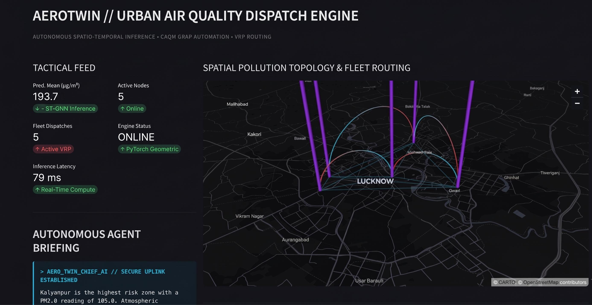
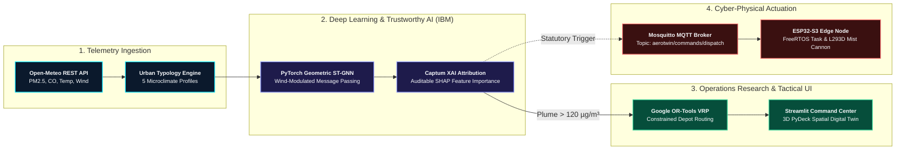

# AeroTwin: Cyber-Physical Air Quality Management System


## Executive Summary
AeroTwin is an enterprise-grade Cyber-Physical System (CPS) and digital twin platform engineered for autonomous municipal air quality management. Developed for the IBM Competition, this solution directly addresses the critical urban challenge of extreme PM2.5 atmospheric pollution. 

Instead of acting merely as a passive dashboard, AeroTwin actively closes the loop between software and the physical world. It seamlessly ingests real-time environmental telemetry, forecasts atmospheric pollution propagation using Spatio-Temporal Graph Neural Networks (ST-GNNs), dynamically routes physical mitigation assets via Operations Research integer linear programming, and autonomously dispatches downlink commands to edge microcontrollers (ESP32/Arduino) to actuate physical hardware (e.g., mist cannons, water sprinklers) in the real world.

The system is designed to completely automate the Indian government's Graded Response Action Plan (GRAP) without requiring manual human intervention.

---

## The Core Problem: The Delayed Air Quality Response Gap
In rapidly developing urban centers like Lucknow, extreme atmospheric pollution (PM2.5) events cause severe public health crises and economic disruption. Currently, municipal responses are fundamentally **reactive**. Environmental data is collected, manually analyzed by human operators on static dashboards, and subjected to bureaucratic delays before physical mitigation assets (like water sprinklers or mist cannons) are finally deployed. 

**The consequence:** By the time a mitigation asset reaches a critical pollution zone, the PM2.5 cloud has already advected (drifted) across the city, rendering the response completely ineffective.

AeroTwin solves this by predicting pollution drift *before* it happens and automatically dispatching physical assets to intercept it, entirely removing the human bottleneck.

---
## MVP Command Center


*(AeroTwin Tactical Spatial Theater, VRP Routing, and LLM Agent Briefing)*

---

## Key Features & Innovation
- **Autonomous Spatio-Temporal Forecasting**: Real-time integration with Open-Meteo APIs feeds a PyTorch Geometric ST-GNN to predict spatial pollution drift 24 hours into the future across disaggregated urban microclimate typologies (industrial clusters, transit corridors, commercial cores).
- **Explainable AI (XAI) & Algorithmic Trust (IBM Trustworthy AI)**: Aligned with IBM's principles of Trustworthy AI and algorithmic governance, PyTorch Captum integration provides real-time SHAP feature attributions. This demystifies the "black-box" neural network by mathematically proving which environmental variables (e.g., wind advection, thermal inversions, CO concentrations) drove a forecast, ensuring that high-stakes municipal interventions are transparent, auditable, and legally defensible.
- **Cloud-Native Enterprise Architecture (IBM Cloud / Red Hat OpenShift Ready)**: Engineered for municipal scalability, the system decouples deep learning inference (FastAPI), tactical spatial command visualization (Streamlit), and asynchronous edge telemetry (Eclipse Mosquitto) into isolated containerized microservices ready for enterprise hybrid-cloud deployment.
- **Generative AI Commissioner Briefings**: Continuously translates complex multi-dimensional GNN prediction tensors into concise, fluid executive briefings for city commissioners, outlining risk corridors and confirming statutory GRAP mandates.
- **Constrained Operations Research VRP Routing**: Google OR-Tools dynamically solves the Vehicle Routing Problem (VRP) to calculate optimal mitigation fleet trajectories from the Central Municipal Depot to intercept critical pollution plumes (PM2.5 > 120 µg/m³).
- **Closed-Loop Cyber-Physical Actuation**: Transcends passive dashboards by maintaining physical control over municipal hardware. Statutory emergency triggers immediately dispatch MQTT payloads to ESP32-S3 edge nodes, driving physical pumps and mist cannons via PWM/motor drivers in the field.

---

## Architecture Overview

AeroTwin operates as a closed-loop Cyber-Physical System (CPS), bridging real-time atmospheric telemetry with deep learning forecasting, operations research routing, and physical edge actuation.



| Subsystem Layer | Core Technologies | Protocol / Interface | Responsibilities |
| :--- | :--- | :--- | :--- |
| **1. Ingestion** | Open-Meteo REST API, Pandas | HTTP REST / JSON | Disaggregates regional atmospheric readings across 5 urban typologies |
| **2. Inference (IBM)** | PyTorch Geometric, Captum XAI | Tensor Core / CPU Batch | Predicts 24h particulate advection; calculates auditable SHAP attributions |
| **3. Operations** | Google OR-Tools, Streamlit, PyDeck | Inter-Process / WebSocket | Solves constrained VRP fleet routes; renders tactical 3D digital twin |
| **4. Edge Actuation** | ESP-IDF (C), FreeRTOS, Mosquitto | MQTT (1883) / GPIO PWM | Transmits event downlinks; actuates physical L293D mist cannon & status LED |


## Mathematical & Algorithmic Foundations

### 1. Spatio-Temporal Feature Engineering
To capture temporal dependencies before spatial aggregation, the system calculates lag operators and rolling windows over historical time-series data:

$$
\text{PM2.5}_{t, \text{lag}} = \text{PM2.5}_{t-1}
$$

$$
\text{PM2.5}_{\text{MA}(24)} = \frac{1}{24} \sum_{k=0}^{23} \text{PM2.5}_{t-k}
$$

### 2. PyTorch Geometric Message-Passing Graph (ST-GNN)
The spatial advection of particulate matter is modeled using a Message Passing Neural Network where wind vectors act as edge attributes modulating the transfer of pollution between geographical nodes:

$$
h_i^{(l+1)} = \text{ReLU} \left( W_{\text{update}} \cdot \left[ h_i^{(l)} \parallel \sum_{j \in \mathcal{N}(i)} \text{ReLU}\left( W_{\text{msg}} \cdot [h_j^{(l)} \parallel W_{\text{edge}} e_{j,i}] \right) \right] \right)
$$

Where $h_i$ represents the node state (chemical composition), and $e_{j,i}$ represents the edge state (wind speed and distance).

### 3. Constrained Vehicle Routing Problem (VRP)
The routing of mitigation assets from the central municipal hub is modeled as an Integer Linear Program (ILP) solved via Google OR-Tools:

$$
\text{Minimize} \sum_{i \in V} \sum_{j \in V} \sum_{k \in K} c_{ij} x_{ijk}
$$

Subject to:

$$
\sum_{j \in V} x_{0jk} = 1, \quad \forall k \in K \quad (\text{Vehicles leave the depot})
$$

$$
\sum_{i \in V} \sum_{k \in K} x_{ijk} = 1, \quad \forall j \in V \setminus \{0\} \quad (\text{Every critical node is visited exactly once})
$$

---

## Statutory Policy Automation (GRAP)

AeroTwin autonomously translates continuous atmospheric data into discrete legal policy interventions based on the Commission for Air Quality Management (CAQM) thresholds:

| Stage | PM2.5 Threshold (µg/m³) | Statutory Category | Automated Hardware Mitigation Dispatch |
| :---: | :--- | :--- | :--- |
| **Normal** | < 60.0 | Good / Moderate | Routine Monitoring (Standby) |
| **Stage I** | 60.0 - 120.0 | Poor | `MECHANIZED_ROAD_SWEEPING` |
| **Stage II** | 120.1 - 250.0 | Very Poor | `WATER_SPRINKLER_HIGH_DENSITY` |
| **Stage III** | 250.1 - 350.0 | Severe | `PRIORITY_1_MIST_CANNON_DISPATCH` |
| **Stage IV** | > 350.0 | Severe+ | `EMERGENCY_CLOSURE_AND_VEHICLE_BAN` |


## Hardware & Edge Specification

AeroTwin transcends digital software by maintaining physical authority over municipal hardware. The platform provides both a native embedded C firmware implementation for production hardware and a Python simulation daemon for edge emulation.

### 1. Native Embedded Firmware (`esp32_edge_actuator/`)
- **Microcontroller**: ESP32-S3 (ESP32-S3-N16R8 CAM Module).
- **Firmware Framework**: Espressif ESP-IDF (C) + FreeRTOS preemptive multitasking.
- **Networking**: IEEE 802.11 b/g/n Wi-Fi with automatic reconnection logic and event-driven IP provisioning.
- **Messaging**: Native `esp_mqtt_client` subscribed to `aerotwin/commands/dispatch`.
- **Physical Actuation Circuit**:
  - **Onboard WS2812 NeoPixel RGB LED (GPIO 48)**: Driven via RMT peripheral (`led_strip` component). Illuminates RED during active mitigation cycles.
  - **L293D Dual Motor Driver (GPIO 4 & GPIO 5)**: Drives high-pressure water sprinkler pump and mist cannon motors.
- **Deterministic Mitigation Routine**: Upon detecting Stage III/IV statutory alerts, a dedicated FreeRTOS worker task (`trigger_mitigation_task`) engages the motor driver and status indicator for a 10-second mitigation cycle without blocking the MQTT communication thread.

### 2. Edge Software Daemon (`edge_actuator.py`)
- Python-based simulation daemon with `gpiozero` mock fallback for testing the closed-loop MQTT downlink on laptops, workstations, or Raspberry Pi single-board computers without physical hardware connected.

---

## Local Development Setup

### 1. Configure Environment
Copy the example environment file and insert your Google Gemini API key:
```bash
cp .env.example .env
# Edit .env and set GEMINI_API_KEY=your_key_here
```
*(Note: If no API key is provided, the backend automatically provides a resilient synthetic executive briefing).*

### 2. Spin Up Containerized Microservices
Launch the complete stack (Mosquitto MQTT Broker, FastAPI Inference Engine, and Streamlit Spatial Dashboard):
```bash
docker compose up -d --build
```
- **Streamlit Command Center**: [http://localhost:8501](http://localhost:8501)
- **FastAPI Backend & API Docs**: [http://localhost:8000/docs](http://localhost:8000/docs)
- **Mosquitto MQTT Broker**: `localhost:1883`

### 3. Verify Closed-Loop Hardware & Pipeline
Open the Streamlit Command Center at [http://localhost:8501](http://localhost:8501):
- **⚡ Spike Test**: Click the sidebar test trigger. This simulates an acute atmospheric PM2.5 surge, calculates emergency VRP mitigation routes from the Central Municipal Depot, and broadcasts an emergency MQTT downlink command (`WATER_SPRINKLER_HIGH_DENSITY`, `Stage IV`) to `aerotwin/commands/dispatch`.
- **Physical Actuation Feedback**: If the ESP32-S3 edge node is connected, its onboard WS2812 NeoPixel (GPIO 48) illuminates RED and the L293D motor driver (GPIO 4 & 5) engages the water cannon/sprinkler pump for a non-blocking 10-second mitigation cycle.
- **🔄 Reset Live**: Click the reset trigger to restore live ambient telemetry and broadcast a `STANDBY` command to edge actuators.

### 4. Flash ESP32-S3 Edge Actuator (Optional Hardware Step)
To flash the native actuator firmware onto an ESP32-S3 board:
```bash
cd esp32_edge_actuator
idf.py set-target esp32s3
idf.py build flash monitor
```

## Author & Academic Attribution

**Alfayez Ahmad**  
Department of Computer Science & Engineering  
Specialization: Cloud Computing & Artificial Intelligence  
Integral University, Lucknow, India  

*Distributed under the MIT License. Copyright © 2026 Alfayez Ahmad.*